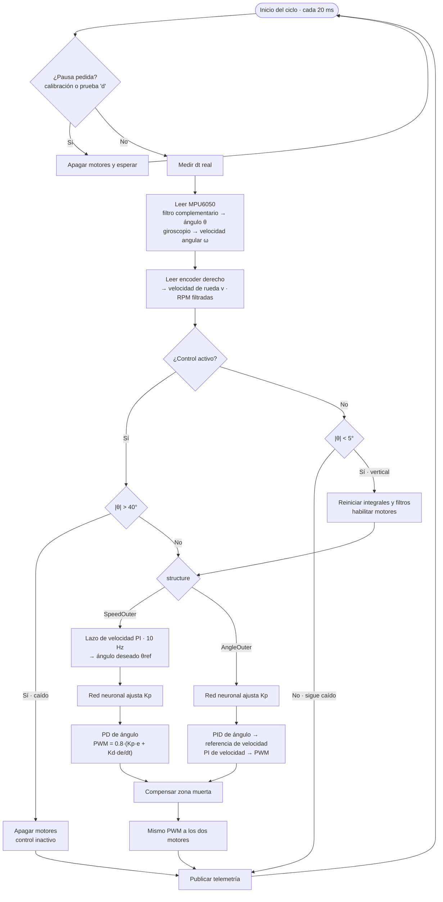
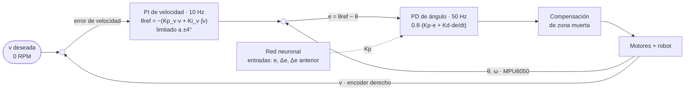
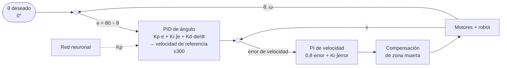
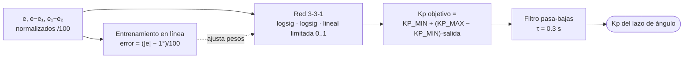

# 🤖 Balancín-ControlRN (ESP32-S3)

> Basado en repositorio: `git@github.com:eatechnology1/Balancin-ControlRN.git`

Firmware y laboratorio web para un **robot balancín** (péndulo invertido sobre dos ruedas) basado en **ESP32-S3**.

- **Control en cascada `RpmCascade`** (por defecto desde fw 0.8.1): lazo de RPM de cada rueda → lazo de ángulo → lazo de posición, velocidad y rumbo. El robot se equilibra, vuelve a su sitio y se puede conducir.
- Las estructuras anteriores (`SpeedOuter`, `AngleOuter`, con una **red neuronal** que ajusta `Kp`) siguen disponibles para comparar.
- **HMI web** (carpeta `hmi/`): trazas en vivo, parámetros, banco de motores, conducción e historial, desde el PC, la tablet o el celular.

> 🚀 ¿Primera vez? Ve directo a la [puesta en marcha paso a paso](#-puesta-en-marcha-paso-a-paso).

---

## 🚀 Puesta en marcha paso a paso

### 0. Qué necesitas

| Para | Necesitas |
|---|---|
| Cargar el firmware | Cable USB, [PlatformIO](https://platformio.org/install/cli) (CLI o la extensión de VS Code) |
| Usar el robot | Batería LiPo 2S cargada (8.4 V) |
| La HMI (opcional) | Python ≥ 3.11 y Node ≥ 20 |

### 1. Descargar el código

```bash
git clone git@github.com:JeissonMartinez/robot-balancin.git
```
```bash
cd robot-balancin
```
```bash
git checkout feat/fw-cascada-rpm
```

### 2. Cargar el firmware

1. **Desconecta el cable del encoder derecho** de la PCB (ver [por qué](#6-problemas-frecuentes)).
2. Conecta el robot por USB.
3. Pon el ESP32 en modo descarga: **mantén BOOT, pulsa y suelta RESET, suelta BOOT**.
4. Compila y carga:
   ```bash
   pio run -t upload
   ```
5. Reconecta el encoder derecho y pulsa **RESET** una vez.

### 3. Primer encendido

1. Abre el monitor serie para ver qué pasa (opcional):
   ```bash
   pio device monitor
   ```
   Al arrancar imprime la versión, de dónde salen los parámetros y la estructura de control. Debe decir `RpmCascade`.
2. Si nunca se calibró la IMU (el arranque dice «No existe calibración guardada»): pon el robot **quieto y vertical** y pulsa el botón de calibración (o la tecla `c` en el monitor).

### 4. Usarlo sin la HMI

1. Enciende el robot con la batería.
2. Ponlo vertical en el piso, sosténlo suave y suéltalo: el control se activa solo cuando el ángulo baja de 5° y el robot se equilibra y se queda en su sitio.
3. Si se cae (más de 40°), los motores se apagan. Vuelve a ponerlo vertical para reactivarlo.

Si no arranca en `RpmCascade` (por ejemplo, tenía guardados parámetros de otra versión), vuelve a los valores de fábrica y guárdalos. En el monitor serie (paso 3), pega estas dos líneas, una a la vez:

```
{"type":"cmd","id":1,"cmd":"defaults"}
```
```
{"type":"cmd","id":2,"cmd":"save"}
```

Teclas útiles en el monitor: `e` parada de emergencia, `a` liberarla, `p` ver los parámetros, `w` ver el WiFi, `?` ayuda ([lista completa](#comandos-por-el-monitor-serie)).

### 5. Usarlo con la HMI

**Arrancar** (desde la carpeta del repositorio; la primera vez instala todo y compila la interfaz, después sólo arranca):

```bash
hmi/iniciar.sh
```

Abre **http://127.0.0.1:8000** en el navegador. Desde el celular o la tablet, abre la dirección «HMI en la red» que imprime el comando (deben estar en la misma WiFi que el PC).

**Conectar el robot** (tarjeta Conexión):

| Transporte | Cómo |
|---|---|
| **USB** | Elegir el puerto del robot → Conectar. Cierra antes el monitor serie. |
| **WiFi, red del robot** | Une el PC a la red `Balancin-XXXX` (clave `bal-xxxxxx`, la muestra la tecla `w`) → WiFi, dirección `192.168.4.1` → Conectar. |
| **WiFi, tu red** | Si el robot está configurado en tu red local, une el PC a esa red → WiFi, dirección `balancin-xxxx.local` o su IP → Conectar. |

**Qué hacer en la HMI:**

- **En vivo:** ángulo, ruedas, posición y rumbo; escena 2D/3D.
- **Conducir:** mantener pulsados los botones ▲▼◀▶ (o las flechas del teclado). Al soltar, el robot se detiene. «Volver al inicio» lo regresa a donde se armó.
- **Parámetros:** ajustar en vivo. **«Guardar en el robot»** los deja para que arranque así sin la HMI.
- **Motores:** banco de motores (con el robot sobre un soporte): diagnóstico de encoders, ensayos y lazo de RPM.
- **Historial:** cada sesión queda guardada con su telemetría; se puede reproducir y exportar a CSV.
- **Parada:** botón rojo o tecla `Esc`.

Más detalle en [hmi/README.md](hmi/README.md).

### 6. Problemas frecuentes

| Síntoma | Causa y solución |
|---|---|
| La carga falla con `Wrong boot mode` | GPIO 46 (canal B del encoder derecho) también decide el modo de arranque: **desconecta el encoder derecho** mientras cargas y usa BOOT + RESET (paso 2). |
| Tras cargar, la HMI dice «el robot no responde» | El chip quedó en modo descarga: pulsa **RESET**. |
| No compila: falta `Network.h` o errores en `mqtt_link.cpp` | Usa la plataforma fija de `platformio.ini` (`espressif32@6.12.0`); no la cambies por pioarduino. |
| La HMI se ve vieja después de actualizar | Recarga sin caché (Safari ⌥⌘R, Chrome Ctrl+Shift+R) y reinicia `hmi/iniciar.sh`. |
| No aparece la red `Balancin-XXXX` | El robot está configurado en tu red local: tecla `w` en el monitor para ver dónde está, o cámbialo en la tarjeta «WiFi del robot» de la HMI. |
| No arranca en `RpmCascade` | Hay parámetros guardados de otra versión: `defaults` + `save` (paso 4) o «Guardar en el robot» desde la HMI. |
| El robot se queda equilibrado pero desplazado | El ángulo de equilibrio (`setpoint_angle`, −2° de fábrica) no coincide con el real: ajústalo en la HMI hasta que quede en su sitio. |

---

## ✨ Características principales

- 🦾 **Tres estructuras de control** que se eligen en ejecución (parámetro `structure`), sin perder los parámetros de ninguna:
  - **`RpmCascade`** (por defecto desde fw 0.8.1): el lazo de ángulo pide aceleración de rueda, que se integra en la RPM deseada de un lazo de RPM (prealimentación + PI). Suma términos de posición y velocidad para volver a su sitio y conducir, y corrige el rumbo con el giroscopio. Corre a 200 Hz.
  - `SpeedOuter` (por defecto hasta fw 0.8.0; desde 0.8.1 arranca `RpmCascade`): estructura estándar de balancín. Un PI de velocidad fija el ángulo deseado y un PD de ángulo genera el PWM. Mantiene el robot en su sitio.
  - `AngleOuter`: estructura original. Un PID de ángulo genera una referencia de velocidad y un PI de velocidad genera el PWM.
- 🧠 **Red neuronal** (3-3-1, librería local `Neural_Networks_FF`) que adapta `Kp` entre `KP_MIN` y `KP_MAX`. Si ambos valen lo mismo, `Kp` queda fija.
- 📐 **Ángulo** con filtro complementario (0.98 giroscopio / 0.02 acelerómetro) y el filtro pasa-bajas interno del MPU6050 a 42 Hz.
- ⚙️ **Zona muerta de motores** compensada de forma continua (sin saltos en PWM = 0), con una prueba automática para medirla.
- 🕒 **FreeRTOS**: `TaskBalanceo` en el núcleo 1 (200 Hz en `RpmCascade`, 50 Hz en las otras), con período fijo (`vTaskDelayUntil`) y `dt` medido. Telemetría a 50 Hz.
- 🕹️ **Conducción** (fw 0.9.0): comando `drive` (velocidad y giro) que se vence en 1 s si no se renueva; desde la HMI con botones o flechas.
- 🛡️ **Seguridad**: motores apagados si |ángulo| > 40°; se reactivan con el robot vertical (|ángulo| < 5°).
- 💾 **Calibración persistente** de la MPU en memoria no volátil (NVS), sin interrumpir una lectura I2C.
- 🎚️ **Parámetros ajustables en ejecución** (ganancias, estructura, RN, zona muerta, seguridad) por comandos JSON, validados y guardables en NVS. Base de la [HMI](#️-hmi).
- 🛑 **Parada de emergencia** remota.
- 📶 **WiFi**: red propia `Balancin-XXXX` (clave única por robot) o red local, con WebSocket para la HMI; el control sigue solo en su núcleo.
- 📡 **MQTT** opcional (`balancin/<robot>/in|out|status`) para usar un broker como Mosquitto.
- 🧪 **Banco de motores** (fw 0.6.0): diagnóstico de cada encoder (cuentas, flancos por canal, sentido) y ensayos de lazo abierto de cada motor, desde la pestaña Motores de la HMI.

---

## 🧭 Lógica de control

### Diagrama general del ciclo de control (cada 20 ms)



### Estructura `SpeedOuter`



1. **Lazo externo de velocidad (PI, 10 Hz)**: promedia la velocidad de la rueda en cada período de 100 ms y calcula el ángulo deseado:
   $\theta_{ref} = \theta_0 - \text{sat}_{\pm 4°}\left(K_p^v\,v + K_i^v \int v\,dt\right)$.
   - Si el robot avanza, baja `θref` y el lazo interno lo frena.
   - El término integral (proporcional a la distancia recorrida) lo devuelve a su posición inicial. También absorbe la diferencia entre el cero calibrado y el punto de equilibrio real.
   - El signo lo fija `SPEED_LOOP_SIGN = -1` (ver [Por qué el signo es −1](#-por-qué-el-signo-del-lazo-de-velocidad-es-1)).
2. **Lazo interno de ángulo (PD, 50 Hz)**: `PWM = 0.8·(Kp·e + Kd·de/dt)`, con `e = θref − θ`.
   - La derivada usa directamente el giroscopio (`de/dt = −ω`): menos ruido y sin retardo.
   - El factor 0.8 (`ANGLE_LOOP_PWM_GAIN`) hace que `Kp` y `Kd` signifiquen lo mismo que en `AngleOuter`.
3. **Red neuronal**: ajusta `Kp` en cada ciclo (ver más abajo).

### Estructura `AngleOuter` (original)



Se conserva para comparar. Como la referencia de velocidad (±300 RPM) es inalcanzable para motores de unas 70 RPM, en la práctica se comporta como un PID de ángulo directo al PWM y no corrige que el robot se desplace.

### Red neuronal (Kp adaptativa)



- Si |e| > `NN_ERROR_BAND` (1°), la red sube `Kp`; si es menor, la baja.
- La salida está limitada a [0, 1], así que `Kp` nunca sale de `KP_MIN..KP_MAX` ni cambia de signo.
- El filtro evita que `Kp` salte entre sus límites de un ciclo a otro, lo que producía vibración.
- Configuración actual: `KP_MIN = KP_MAX = 70`, es decir, `Kp` fija. Es el valor con el que el robot se sostiene; la sintonía manual previa halló estable el rango 50-70.

### Compensación de zona muerta

Por debajo de un PWM de unos 22-26 (medido con la prueba `d`), los motores no vencen la fricción ni el juego de la reductora. El PWM del controlador `u` se transforma así:

- $|u| \ge 4$: $u_{motor} = \text{signo}(u)\cdot\left(DB + |u|\cdot\frac{255-DB}{255}\right)$
- $|u| < 4$: interpolación lineal desde 0, para que el ruido en reposo no se convierta en golpes.

Se usa `PWM_DEADBAND = 14`, menos que lo medido: arrancar desde parado cuesta más que mantener el giro, y compensar de más produce vibración. Con 0 se desactiva.

### 🔄 Por qué el signo del lazo de velocidad es −1

Los motorreductores (1:119) se comportan casi como fuentes de velocidad. Con el lazo interno PD, en régimen permanente el robot avanza unas 15 RPM por cada grado que `θref` está por encima del punto de equilibrio. En la primera versión, avanzar subía `θref`: eso lo hacía avanzar más, una realimentación positiva. El robot equilibraba al arrancar y luego se alejaba cada vez más rápido, como si el cero se hubiera corrido. Con el signo −1, avanzar baja `θref` y frena al robot.

---

## 🧩 Estructura del código

| Archivo | Contenido |
|---|---|
| `src/main.cpp` | `setup()` y `loop()`: inicialización, botón de calibración, lectura del Serial (teclas y líneas JSON) y envío de telemetría. |
| `include/config.h` | Pines, PWM, encoders y valores de fábrica de los parámetros ajustables. |
| `params.h/.cpp` | Parámetros activos en RAM: validación, cambio en ejecución, NVS y descripción (`schema`). |
| `wifi_link.h/.cpp` | WiFi (red propia / red local / apagado, en NVS), servidor WebSocket y mDNS. Los comandos por WiFi se atienden en `loop()`. |
| `mqtt_link.h/.cpp` | Canal MQTT opcional (esp-mqtt), configuración en NVS. |
| `console.h/.cpp` | Salida de texto para humanos por Serial y WiFi a la vez. |
| `protocol.h/.cpp` | Protocolo con la HMI: comandos JSON, respuestas y formato de telemetría (`docs/hmi/PROTOCOLO.md` (documentación interna)). |
| `encoders.h/.cpp` | Encoders con el contador por hardware (PCNT) en cuadratura x4 y filtro de glitches; RPM filtradas; flancos por canal y nivel de los pines para el diagnóstico. |
| `rpm_loop.h/.cpp` | Lazo de RPM de una rueda: prealimentación + PI con modelo de referencia (lo usan el banco y `RpmCascade`). |
| `rpm_cascade.h/.cpp` | Estructura `RpmCascade`: el lazo de ángulo pide aceleración de rueda, que se integra en la RPM deseada del lazo de RPM (200 Hz). |
| `bench.h/.cpp` | Banco de motores: con el control en pausa, PWM manual por motor y ensayos de tramos `[PWM, ms]` muestreados cada 1–20 ms en RAM. |
| `motors.h/.cpp` | PWM LEDC, driver TB6612FNG y compensación de zona muerta. |
| `mpu_block.h/.cpp` | MPU6050: conexión, filtro pasa-bajas, calibración en NVS y filtro complementario. |
| `nn_cascade_block.h/.cpp` | Red neuronal, las dos estructuras de control y sus ganancias. |
| `tasks_block.h/.cpp` | `TaskBalanceo`, seguridad, parada de emergencia, pausa y reanudación, y cola de telemetría (50 Hz). |
| `motor_test.h/.cpp` | Prueba de zona muerta de los motores (comando `d`). |
| `lib/Neural_Networks_FF`, `lib/Dynamic_Array` | Librerías locales de la red neuronal. |

En `test/` se guardan sketches y versiones anteriores (`*.old`) como histórico; no se compilan.

---

## 🎛️ Parámetros de ajuste

Los valores de `config.h` son los **de fábrica**. En ejecución se cambian con el comando `set` (por Serial hoy, desde la HMI después) y se guardan con `save` en NVS. Si hay parámetros guardados, **al arrancar mandan sobre `config.h`**; para volver a fábrica: `defaults` y `save`. Lista completa, rangos y reglas en `docs/hmi/PROTOCOLO.md` (documentación interna).

| Clave | Constante (`config.h`) | Fábrica | Qué hace |
|---|---|---|---|
| `structure` | `CONTROL_STRUCTURE` | `RpmCascade` | Estructura de control activa (`RpmCascade` / `SpeedOuter` / `AngleOuter`). |
| `setpoint_angle` | `SETPOINT_ANGLE` | −2° | Ángulo de equilibrio (depende de la calibración de la IMU). |
| `k_theta`, `k_omega` | `K_THETA`, `K_OMEGA` | 42.4 / 8 | `RpmCascade`: aceleración de rueda por grado y por °/s. |
| `k_vel`, `k_x` | `K_VEL`, `K_X` | 2 / 152.4 | `RpmCascade`: términos de velocidad y de posición. |
| `rpm_kp`, `rpm_ki` | `RPM_KP_DEFAULT`, `RPM_KI_DEFAULT` | 1.33 / 67 | Lazo de RPM. |
| `k_psi`, `k_r`, `yaw_sign` | `K_PSI`, `K_R`, `YAW_SIGN` | 5 / 2 / +1 | Rumbo con el giroscopio (corrige el motor izquierdo). |
| `v_ref_max`, `r_ref_max` | `V_REF_MAX`, `R_REF_MAX` | 20 RPM / 30 °/s | Velocidad y giro máximos al conducir. |
| `kp_min`, `kp_max` | `KP_MIN`, `KP_MAX` | 70 / 70 | Rango de `Kp` que puede elegir la red. Iguales = `Kp` fija. |
| `kd_angle` | `KD_ANGLE` | 1.25 | Acción derivativa del lazo de ángulo (amortigua). |
| `kp_v`, `ki_v` | `KP_V`, `KI_V` | 0.05 / 0.03 | Ganancias del lazo de velocidad (`SpeedOuter`). |
| `speed_sign` | `SPEED_LOOP_SIGN` | −1 | Signo del lazo de velocidad. |
| `max_tilt_ref` | `MAX_TILT_REF_DEG` | 4° | Límite del ángulo deseado que puede pedir el lazo de velocidad. |
| `ki_angle`, `kp_speed`, `ki_speed` | `KI_ANGLE`, `KP_SPEED`, `KI_SPEED` | 1.0 / 0.8 / 0 | Ganancias de `AngleOuter`. |
| `pwm_deadband` | `PWM_DEADBAND` | 14 | Compensación de zona muerta (0 = desactivada). |
| `mpu_dlpf` | `MPU_DLPF_MODE` | 3 (42 Hz) | Filtro pasa-bajas interno del MPU6050. |
| `max_angle`, `rearm_angle` | `MAX_ANGLE`, `REARM_ANGLE` | 40° / 5° | Ángulo de caída y de reactivación. |

Pines, PWM, encoders y período de control siguen fijos en `config.h`.

**Guía rápida con `RpmCascade`**:
- Si oscila rápido o vibra, baja `k_theta` y `k_omega`.
- Si no vuelve a su sitio o se queda desplazado, sube `k_x` o ajusta `setpoint_angle`.
- Si al avanzar en línea recta gira cada vez más, cambia `yaw_sign`.

**Guía rápida con `SpeedOuter`**:
- Si el robot se aleja cada vez más rápido y `Ref` se queda en ±4°, cambia `SPEED_LOOP_SIGN`.
- Si oscila lento adelante-atrás (1-3 s), baja `Ki_v` y luego `Kp_v`.
- Si vibra rápido alrededor del equilibrio, baja `Kp` o `PWM_DEADBAND`.

---

## 🔧 Hardware

- 🧩 **Placa**: ESP32-S3 (N16R8), configurada como `esp32-s3-devkitm-1`.
- 🎛️ **IMU**: MPU6050 (I2C, SDA=41, SCL=42).
- ⚙️ **Driver de motores**: TB6612FNG.
  - Canal A (rueda **derecha**): `AIN1`=7, `AIN2`=6, `PWMA`=5.
  - Canal B (rueda **izquierda**): `BIN1`=16, `BIN2`=17, `PWMB`=18.
  - `STBY`=15.
- 🚗 **Motores** 25GA370 12 V 100 RPM con encoder, leídos en cuadratura x4 con el contador por hardware (PCNT): **2 618 cuentas por vuelta de rueda** (medido). Con LiPo 2S llegan a unas 60 RPM.
  - Encoder derecho A/B = 3/46.
  - Encoder izquierdo A/B = 9/11. Su sensor B está dañado: el lazo de RPM se cierra con la rueda derecha y el izquierdo recibe el mismo PWM más una corrección de rumbo con el giroscopio.
- 📏 **Geometría**: rueda de 6.5 cm, centro de masa a ~4.5 cm del eje, 675 g.
- 🔘 **Botón de calibración**: `BTN_CAL`=10 (activo en LOW).

Los pines están fijados por la PCB. GPIO 3 y 46 son pines de arranque (*strapping*) del ESP32-S3.

---

## 🧮 Uso

1. **Encendido**: se cargan los parámetros (NVS o fábrica) y se inician los motores (deshabilitados), la MPU6050 y su calibración, los encoders, la red neuronal y la tarea de control. Se imprime la versión, el origen de los parámetros y la estructura de control activa.
2. **Activación**: pon el robot vertical (|ángulo| < 5°) y el control se activa solo.
3. **Caída**: si |ángulo| > 40°, se apagan los motores hasta que vuelva a estar vertical.
4. **Calibración**: con el robot quieto y vertical, pulsa y suelta `BTN_CAL` o envía `c`. El control se pausa, se guardan los offsets y se reanuda.

### Telemetría (Serial, 921600 baudios)

Por defecto sale en texto cada 100 ms (legible en el monitor). Con `j` o el comando `tel` pasa a JSON a 50 Hz, que es lo que usa la HMI (`docs/hmi/PROTOCOLO.md` (documentación interna)).

```
Ang: 0.53 | Ref: -0.21 | w: -4.2 | PWM: -12.4 | RPM L: 0.0 | RPM R: -2.9 | Kp: 70.00 | dt: 0.0200 | ACTIVO
```

| Campo | Significado |
|---|---|
| `Ang` | Ángulo medido (°). Negativo = inclinado hacia adelante. |
| `Ref` | Ángulo deseado que pide el lazo de velocidad (siempre 0 en `AngleOuter`). |
| `w` | Velocidad angular del giroscopio (°/s). |
| `PWM` | Salida del controlador, antes de compensar la zona muerta. |
| `RPM L` / `RPM R` | Velocidad de cada rueda. Positiva = avance. |
| `Kp` | `Kp` actual del lazo de ángulo. |
| `dt` | Período real del ciclo de control (s). |
| Estado | `ACTIVO`, `MOTORES OFF` (caído o esperando vertical) o `PARADA DE EMERGENCIA`. |

### Comandos por el monitor serie

Escribe la letra en el monitor (no hace falta Enter):

| Tecla | Acción |
|---|---|
| `d` | Prueba de zona muerta. Sujeta el robot vertical con las ruedas en el suelo: sube el PWM hasta que la rueda derecha gira de forma sostenida e imprime el PWM mínimo en cada sentido. Cualquier tecla la aborta. |
| `c` | Calibrar la MPU (igual que el botón). |
| `t` | Pausar o reanudar la telemetría. |
| `j` | Alternar telemetría JSON a 50 Hz / texto a 10 Hz. |
| `e` | Parada de emergencia: motores off y sin re-armado automático. |
| `a` | Liberar la parada de emergencia. |
| `p` | Mostrar los parámetros activos (JSON). |
| `w` | Estado del WiFi: red, clave, dirección. |
| `b` | Entrar o salir del banco de motores (robot sobre un soporte, ruedas en el aire). Al salir queda la parada de emergencia activa. |
| `?` | Ayuda. |

`d` y `c` pausan el control antes de actuar. Al terminar, el control se reactiva cuando el robot se pone vertical.

Una línea que empieza con `{` es un comando JSON (`set`, `get`, `save`, `schema`, ...), descrito en `docs/hmi/PROTOCOLO.md` (documentación interna). Ejemplo: `{"type":"cmd","id":1,"cmd":"set","params":{"kd_angle":1.3}}`.

---

## 🚀 Compilación y carga (PlatformIO)

Resumen (detalle en la [puesta en marcha](#-puesta-en-marcha-paso-a-paso)):

```bash
pio run -t upload
```
```bash
pio device monitor
```

- La plataforma está fija en `espressif32@6.12.0` (Arduino 2.0.17, ESP-IDF 4.4), la que usa el firmware. Sin versión, PlatformIO puede tomar pioarduino (Arduino 3), con la que no compila.
- Si la carga falla con `Wrong boot mode`, desconecta el encoder derecho (GPIO 46 es pin de arranque) y entra en modo descarga con **BOOT + RESET** antes de cargar.
- Las librerías **Neural_Networks_FF** y **Dynamic_Array** están en `lib/` y PlatformIO las detecta automáticamente. MPU6050 y ArduinoJson se descargan desde `lib_deps`.
- El monitor usa 921600 baudios (`monitor_speed` en `platformio.ini` = `SERIAL_BAUD` en `config.h`).
- Verificar el protocolo con el robot conectado: `~/.platformio/penv/bin/python hmi/tools/protocol_check.py` (añadir `--save` para probar la persistencia en NVS).

Más detalle en [Doc_Technical.md](Doc_Technical.md).

---

## 🖥️ HMI

Laboratorio web para monitorear, sintonizar y registrar el robot desde el PC o el celular.

> La documentación de diseño de la HMI (`docs/`: plan y fases, protocolo, API del gateway) es interna y no se publica en este repositorio.

Conexión por USB, WiFi o MQTT (o con un robot simulado, sin hardware); escena 2D/3D y trazas a 50 Hz con marcas de eventos; parámetros en vivo y juegos de parámetros; **conducción** con botones o flechas; **banco de motores** (diagnóstico de encoders, ensayos, lazo de RPM); parada de emergencia; historial de cada sesión en SQLite con reproducción, tabla y CSV. Desde PC, tablet o celular. Instalación y uso en [hmi/README.md](hmi/README.md).

```bash
hmi/iniciar.sh        # y abrir http://127.0.0.1:8000 (o desde el celular la dirección que imprime)
```
